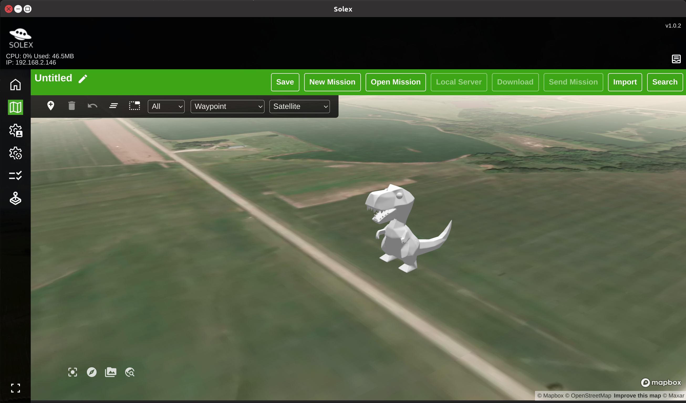

# Custom 3D vehicle marker

It's pretty easy to make a custom 3D marker for your vehicle. You need a way to make GLB files, and something to specify the settings for displaying the marker on the map. 

In this directory you'll find an example .glb file made from a simple STL model of a copter. Blender was used to import the STL file, scale it, apply a color to its surface, and export to .glb (GLTF 2.0 format). 

The `wren.json` file looks like this:

```json
{
    "type": "gltf",
    "obj": "wren.glb",
    "scale": 3,
    "units": "meters",
    "anchor": "auto",
    "rotation": { "x": 90, "y": 0, "z": 0 }
}

```

**`type`** is `gltf` for .glb files.
**`obj`** is the name of the file, and must be in the same directory as the .json file.
**`scale`** is used to manipulate the size of the object on the map. 
**`units`** is nearly always `meters` (consult Threebox documentation for other values, which you'll be doing if you're into this deep enough to specify something other than `meters` for `units`).
**`anchor`** is the anchor point. You can specify things like `center`, `bottom-left`, `bottom-right`, etc. `auto` is used here to use the origin in the model itself.

**`rotation`** is the attribute you'll deal with the most. `x` is the axis parallel to the equator, and is nearly always 90. `y`
is parallel to lines of longitude, and `z` is perpendicular to the earth's surface.



